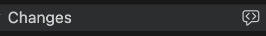

# Photo Gallery & Portfolio: GitHub Copilot Features Demo

A photo gallery and portfolio application built with Next.js 15, TypeScript, and Tailwind CSS. Use it to explore GitHub Copilot's features by planning, implementing, and reviewing a small gallery improvement.

## What You'll Learn

By the end of this demo, you will:

- Understand GitHub Copilot's core features.
- Generate code with AI assistance.
- Plan and implement changes using AI assistance.
- Review and commit AI-generated code.

**Estimated time:** 15-20 minutes

## Getting Started

### Requirements

- Node.js ^18.18.0, ^19.8.0, or 20.0.0 and newer (Node.js 20 is used by the dev container)
- npm
- GitHub Copilot access in your chosen editor or app

### GitHub Codespaces

1. Select **Code** on the repository page, then open the **Codespaces** tab.
2. Select **Create codespace on main** (or your current branch).
3. Wait for the codespace to build and start.

The dev container installs dependencies with `npm install`, starts the development server with `npm run dev`, configures Copilot and other VS Code extensions, and forwards port 3000. Open the forwarded port to access the application.

### Local Installation

1. Clone the repository:
   ```bash
   git clone https://github.com/gpompeo-andela/copilot-200-gallery-feature-demo.git
   cd copilot-200-gallery-feature-demo
   ```
2. Install dependencies:
   ```bash
   npm install
   ```
3. Start the development server:
   ```bash
   npm run dev
   ```
4. Open [http://localhost:3000](http://localhost:3000), then navigate to the gallery.

## Challenge One: Improve Gallery Modal UX

Improve the photo detail modal in [GalleryGrid](src/components/gallery/GalleryGrid.tsx). The behavior below is intentionally left for you to implement.

Choose any of the three workflows below, or combine them.

**Definition of done**

1. Open the gallery page and select **View Details** on a photo.
2. Verify that:
   - [ ] Pressing Escape closes the modal.
   - [ ] Clicking outside the modal content closes it.
   - [ ] The page cannot scroll while the modal is open.
3. Keep the existing modal text, layout, and styling unchanged.

### Option 1: Inline Copilot Suggestions

Use inline suggestions and Next Edit Suggestions to scaffold the improvements.

1. Open [GalleryGrid](src/components/gallery/GalleryGrid.tsx) and find where `selectedPhoto` controls the modal.
2. Add an intent comment near the modal logic, such as `// Close modal on Escape and disable page scroll while modal is open`, and pause for an inline suggestion. If one does not appear, try typing `useEffect(() => {` and pause again.
3. Find the rendered modal and add an intent comment such as `{/* Close modal on backdrop click */}` after the existing modal placeholder comment. Pause for a suggestion; if needed, start typing `onClick={() => {`.
4. Implement one behavior at a time. Use **Next Edit Suggestions** after each accepted change to jump to the next likely edit: Escape handling, backdrop click, then scroll lock.
5. Reject suggestions that change the modal text, layout, or styling, and test all three requirements after each accepted edit.

### Option 2: Copilot Chat

Use Copilot Chat to plan and implement the same fix. Explore Plan mode, Agent mode, the model picker, and auto model selection.

1. Choose Plan mode or Agent mode, preferably whichever you are less familiar with.
2. Choose auto model selection or a model you want to try.
3. Use this prompt:

   ```text
   In GalleryGrid.tsx, improve the photo detail modal UX:
   1) close on Escape,
   2) close on backdrop click,
   3) disable page scroll while modal is open.
   Please keep the current UI and content unchanged.
   ```

### Option 3: Copilot App

The [GitHub Copilot App](https://github.com/features/ai/github-app) offers another way to automate workflows, run sessions, and use your own tools. This option is optional; use Option 1 or 2 if you cannot download the app.

Explore the model picker, agents, and pull request summary and creation:

1. Open the GitHub Copilot App.
2. Select the `+` button next to **Sessions**.
3. Select **Local folder or repository...** and choose this repository.
4. Select your current branch instead of `main`, if different.
5. Explore **Interactive**, **Plan**, and **Autopilot** and choose a workflow.
6. Use the suggested prompt from Option 2 to implement the changes in `GalleryGrid.tsx`.
7. Select **Changes** at the bottom of the chat to inspect the changes.
8. Select **Terminal** and run `npm run dev` to view the changes.
9. Open the `http://localhost:3000` link from the app.
10. When satisfied, use the **Create PR** dropdown to select **Create draft PR**.
11. View the draft in the [repository's pull requests](https://github.com/gpompeo-andela/copilot-200-gallery-feature-demo/pulls) or by selecting its PR number in the app. You may complete the PR to incorporate the change into your branch.

## Challenge Two: Review Your Work

### Option 1: Inline AI-Powered Review

1. Select the generated code.
2. Right-click and select **Review**.
3. Review the feedback and accept or discard suggestions as appropriate.

### Option 2: Source Control AI-Powered Review

1. Open **Source Control** in the Activity Bar.
2. Hover over **CHANGES** and select **Code Review - Unstaged Changes**, as shown below.

   

3. Review any comments shown inline or in the Problems tab.

## Completion Checklist

- [ ] Implement the modal UX improvements in `GalleryGrid.tsx`.
- [ ] Review your work using Copilot's AI-powered review features.
- [ ] Try Copilot features you were not familiar with before this demo.

## Project Structure

```text
src/
├── app/                 # Next.js App Router pages
├── components/          # Reusable React components
├── lib/                 # Mock data and utilities
docs/images/             # Screenshot used by this exercise
```